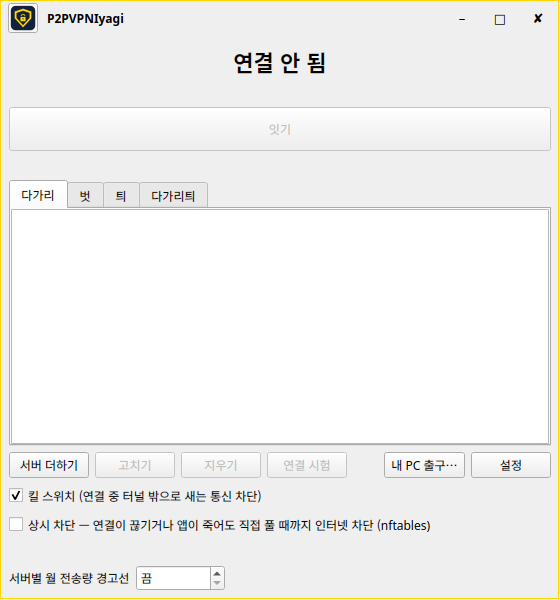

# P2PVPNIyagi

A VPN where you choose the internet exit IP.

인터넷 출구 IP를 내가 고르는 VPN.

- Pick the server your traffic exits from, then connect with one button
- Kill switch blocks traffic outside the tunnel
- Built on WireGuard. Linux first

- 내 통신이 나가는 서버를 고르고 단추 하나로 잇습니다
- 킬 스위치가 터널 밖으로 새는 통신을 막습니다
- WireGuard 기반. 리눅스부터

> Not released yet — downloads will appear under [Releases](../../releases) when it is ready.
> 아직 공개 전입니다. 준비되면 [Releases](../../releases)에 올라옵니다.

